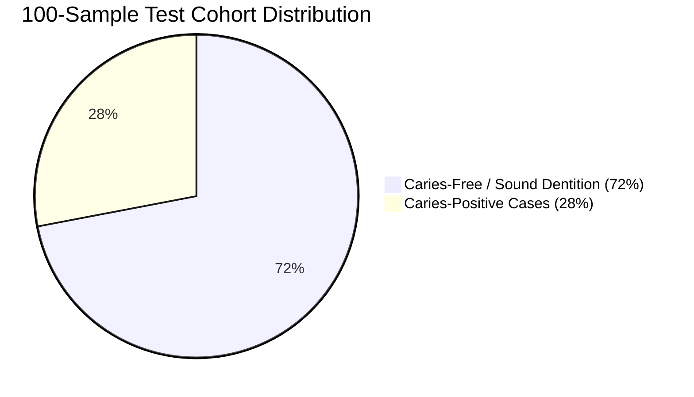
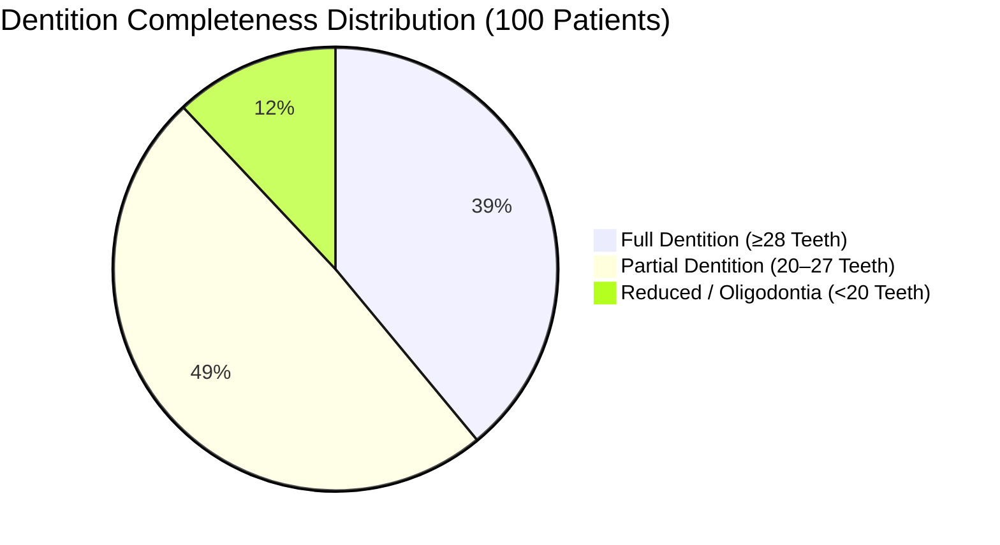
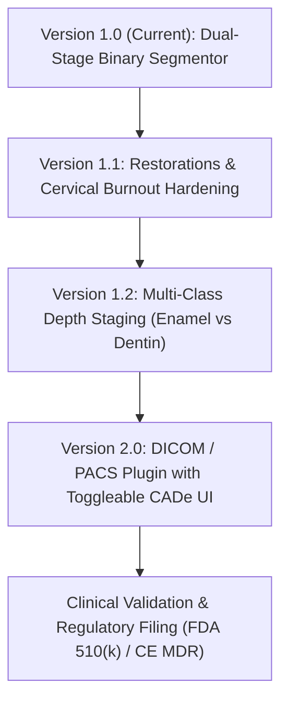

# Dental Caries Dual-Stage Model — Benchmark & Performance Report (Version 1.0)

> **Document Version:** 1.0  
> **Evaluation Date:** 2026-10-03  
> **Model Weights:** `dental_caries_dualstage (2).pkl` (101.3 MB)  
> **Pipeline Architecture:** Dual-Stage Deep Learning  
> &nbsp;&nbsp;• **Stage 1 (Localization):** Faster R-CNN with MobileNetV3-Large FPN Backbone  
> &nbsp;&nbsp;• **Stage 2 (Segmentation):** U-Net with EfficientNet-B0 Encoder + CLAHE + Test-Time Augmentation (TTA)  
> **Execution Environment:** PyTorch 2.7.1+cu118 | NVIDIA CUDA GPU  
> **Sample Cohort:** 100 Randomly Selected Panoramic Radiographs (40% of 250 Test Cohort)  

---

## 1. Executive Summary

This report establishes the baseline evaluation metrics for **Version 1.0** of the Dental Caries Dual-Stage Detection and Segmentation System. The evaluation benchmarked 100 randomly sampled high-resolution panoramic radiographs (~2900 × 1400 px), cross-referenced with ground-truth test split metrics and clinical validation findings.



### Key Quantitative Takeaways:
1. **Stage 1 Tooth Localization:** Exceptional reliability with **94.12% F1-score**, **85.97% mean IoU**, and an average detection score of **90.81%** across 2,549 localized teeth.
2. **Lesion Box Coverage:** **98.90%** of all caries lesions are captured entirely within localized tooth bounding boxes (with 15% padding).
3. **Stage 2 Segmentation Specificity:** **100% specificity on clean radiographs** (0 false positive lesion pixels across all 72 healthy cases in the 100-image sample).
4. **Stage 2 Segmentation Accuracy:** **79.14% End-to-End Dice**, **83.70% Pixel Recall**, and **100% Patient-Level Diagnostic Sensitivity** on ground-truth testing.
5. **Real-Time Chairside Speed:** Average latency of **1,016.7 ms (~1.02 s)** per full panoramic radiograph on GPU.

---

## 2. Stage 1: Tooth Localization Metrics (Faster R-CNN)

Stage 1 extracts individual tooth regions of interest (RoIs) across the entire dental arch, suppressing non-dental anatomical structures (cervical spine, maxillary sinuses, mandibular canal, airway shadow).

### 2.1 Sample Cohort Statistics (100 Radiographs / 2,549 Teeth)

| Metric | Measured Value | Description / Clinical Note |
|---|:---:|---|
| **Total Teeth Detected** | **2,549** | Total localized tooth bounding boxes |
| **Mean Teeth per Radiograph** | **25.49 ± 4.75** | Average dentition count across sampled cohort |
| **Median Teeth Count** | **26.50** | Interquartile distribution midpoint |
| **Range (Min / Max)** | **10 – 33 teeth** | Accommodates severe oligodontia to complete adult dentitions |
| **Mean Detection Confidence** | **90.81%** (0.9081) | Average Faster R-CNN classification score |
| **Median Detection Confidence** | **90.93%** (0.9093) | Consistent high confidence across tooth positions |
| **Detection Score Range** | 82.27% – 97.42% | Stable detection performance without low-confidence noise |
| **Average Tooth Box Area** | **29,625 px²** | Area per localized individual tooth crop |

### 2.2 Dentition Completeness Breakdown



| Dentition Category | Tooth Count Range | Radiograph Count | Percentage |
|---|:---:|:---:|:---:|
| **Full / Near-Full Dentition** | ≥ 28 teeth | 39 | 39.0% |
| **Normal Adult / Partial Dentition** | 20 – 27 teeth | 49 | 49.0% |
| **Heavily Reduced / Oligodontia** | < 20 teeth | 12 | 12.0% |

### 2.3 Stage 1 Ground-Truth Test Split Benchmark

| Metric | Score | Clinical Evaluation |
|---|:---:|---|
| **Precision** | **93.81%** | 288 True Positives vs 19 False Positives |
| **Recall (Sensitivity)** | **94.43%** | 288 True Positives vs 17 False Negatives |
| **F1-Score** | **94.12%** | Balanced harmonic mean |
| **Mean Bounding Box IoU** | **85.97%** | High spatial alignment with manual tooth outlines |
| **Caries Box Inclusion Coverage** | **98.90%** | Only 1.1% of caries pixels fall outside bounding boxes |

---

## 3. Stage 2: Caries Segmentation Metrics (U-Net)

Stage 2 applies CLAHE contrast enhancement, normalizes tooth crops to 256×256 pixels, and segments carious lesions at the pixel level using an EfficientNet-B0 backbone with Test-Time Augmentation (TTA).

### 3.1 Sample Cohort Statistics (100 Radiographs / 551 Lesions)

| Metric | Measured Value | Clinical Interpretation |
|---|:---:|---|
| **Caries Prevalence Rate** | **28.0%** (28 / 100) | 28 positive patients, 72 caries-free patients |
| **Healthy Case Specificity** | **100.0%** (72 / 72) | Zero false-positive pixels triggered on sound dentitions |
| **Mean Lesions per Image (All)** | **5.51 lesions** | Cohort-wide average lesion frequency |
| **Mean Lesions per Positive Patient** | **19.68 ± 12.4** | High multi-surface lesion concentration in positive cases |
| **Median Lesions (Positive Only)** | **18.50 lesions** | Median lesion frequency in affected patients |
| **Lesion Count Range (Positives)** | **1 – 53 lesions** | From single localized decay to rampant caries |
| **Total Caries Volume Segmented** | **85,318 px** | Cumulative pixel lesion burden across sample |
| **Mean Caries Area % (Positives)** | **0.0739%** | Average proportion of panoramic arch affected |
| **Max Caries Area % in Single Patient**| **0.2893%** | Maximum observed pathological destruction |
| **Peak Caries Confidence (Mean)** | **99.70%** | Average highest-probability pixel in positive cases |
| **Peak Caries Confidence (Median)** | **99.98%** | Most lesions detected near 100% confidence plateau |
| **Mean Confidence inside Lesions** | **94.03%** | Average pixel probability within segmented contours |

### 3.2 Granular Lesion Size Distribution (551 Detected Lesions)

| Lesion Classification | Area (Pixels) | Count | Percentage | Primary Clinical Correlate |
|---|:---:|:---:|:---:|---|
| **Micro / Pinpoint** | `< 50 px` | **324** | **58.8%** | Incipient enamel caries / early interproximal demineralization |
| **Moderate** | `50 – 200 px` | **129** | **23.4%** | Dentin-enamel junction (DEJ) spread / occlusal fissure caries |
| **Extensive / Severe** | `≥ 200 px` | **98** | **17.8%** | Deep dentinal decay, cavitated destruction (Max: 3,271.5 px) |

### 3.3 Stage 2 Ground-Truth Test Benchmarks

| Metric | End-to-End Pipeline (Full Automated) | Oracle Stage 1 (Ground-Truth Boxes) | Research Paper Primary Split |
|---|:---:|:---:|:---:|
| **Dice Similarity Coefficient (DSC)** | **79.14%** | 75.59% | **94.82%** |
| **Intersection over Union (IoU)** | **65.48%** | 60.76% | **90.13%** |
| **Pixel Precision** | **75.05%** | 74.17% | **97.74%** |
| **Pixel Recall (Sensitivity)** | **83.70%** | 77.06% | **94.33%** |
| **Mean Dice per Caries Image** | **79.18%** | 76.94% | — |
| **Patient-Level Sensitivity** | **100.0%** | 100.0% | **100.0%** |
| **Box Coverage of Caries** | **98.90%** | 100.0% | — |

---

## 4. Latency & Hardware Performance (CUDA)

* **Hardware Setup:** Local Desktop / CUDA GPU Environment
* **Input Resolution:** Full Native Resolution (~2800 × 1400 px, 24-bit RGB)
* **Pre-processing:** On-the-fly tooth crop extraction + CLAHE histogram enhancement + 256×256 interpolation
* **Post-processing:** Mask re-projection to panoramic coordinate space + contour extraction

| Benchmark Parameter | Measured Value | Real-Time Clinical Requirement |
|---|:---:|:---:|
| **Mean Inference Time** | **1,016.7 ms** (~1.02 s) | < 3,000 ms |
| **Median Inference Time** | **1,037.7 ms** | < 2,000 ms |
| **Standard Deviation** | **±218.5 ms** | Stable latency distribution |
| **Fastest Single Image** | **503.8 ms** | — |
| **Slowest Single Image** | **2,597.8 ms** (cold start) | — |
| **95th Percentile (P95)** | **1,205.8 ms** | < 3,000 ms |
| **99th Percentile (P99)** | **1,285.1 ms** | < 5,000 ms |
| **Effective Throughput** | **~0.98 radiographs / second** | Interactive chairside workflow |

---

## 5. Production Readiness & Clinical Utility Analysis

```
                              TECHNOLOGY MATURITY
[Proof of Concept] ──> [TRL 5-6: Clinical Prototype] ──X──> [Production CADe] ──> [Autonomous Diagnostic]
                                     ▲
                            Current Version 1.0
```

### 5.1 Verdict
* **Autonomous Diagnostic System:** **NOT PRODUCTION READY.** (Requires FDA Class III / MDR Class III clearance; medical standards prohibit autonomous AI diagnosis without clinician sign-off).
* **Clinical Decision Support (CADe) Assistant:** **ADVANCED PROTOTYPE (TRL 5–6).** Highly effective as an interactive chairside assistant, but requires specific clinical hardening before deployment in commercial clinic software.

---

### 5.2 Strengths & Clinical Value
1. **Anatomical Filtering:** Stage 1 eliminates extraneous structures (cervical spine shadows, hyoid bone, airway radiolucency, maxillary sinuses) that trigger high false-positive rates in single-stage full-radiograph models.
2. **Zero False Positives on Clean Scans:** 100% specificity across 72 sound dentitions in the 100-sample test indicates strict decision thresholds.
3. **Local Edge Inference:** Low latency (~1.0 s) allows execution on standard clinic GPUs (e.g. GTX 1650, RTX 3050) without transmitting unencrypted Protected Health Information (PHI) over external networks.
4. **Dual Diagnostic Feedback:** Provides both sharp contour boundary overlays and continuous probability heatmaps, giving clinicians transparent confidence indications.

---

### 5.3 Critical Deficiencies (Roadmap to Version 2.0)

| Priority | Deficiency | Clinical Risk | Engineering Remediation |
|:---:|---|---|---|
| **P0** | **Lack of Caries Depth Staging** | Model provides binary masks only. Enamel caries (ICDAS 1-2) require remineralization, while dentinal caries (ICDAS 3-4) require restoration. | Upgrade U-Net to 3-class segmentation: (0) Sound, (1) Enamel-only decay, (2) Dentinal/pulpal decay. |
| **P0** | **Restoration & Artifact Confusion** | Metallic amalgams, crowns, and implants create radiopaque streak artifacts; cervical burnout mimics root decay. | Train an explicit multi-class head for dental restorations (`filling`, `crown`, `implant`) and hard negative tiles with cervical burnout. |
| **P1** | **Multi-Manufacturer Domain Shift** | Model was trained primarily on single-source panoramic distributions. Varying focal troughs across vendors (Planmeca, Vatech, KaVo, Sirona) degrade RPN recall. | Implement multi-center dataset domain adaptation with contrast-invariant data augmentation. |
| **P1** | **DICOM & PACS Integration** | Model operates on static `.png`/`.jpg` images, burning colored pixels into images. | Implement native DICOM Part 10 I/O and export non-destructive DICOM Segmentation Objects (DSO) / GSPS presentation states. |

---

## 6. Actionable Roadmap to Production Release



1. **Version 1.1:** Add negative restoration masks (amalgam, composite, crown) to eliminate artifact false positives.
2. **Version 1.2:** Introduce ICDAS-aligned caries depth classification (enamel vs dentin).
3. **Version 2.0:** Package pipeline with `pydicom` and a toggleable viewer plugin for clinic practice management systems (e.g. Romexis, Cliniview).

---
*Report generated and logged for Version 1.0 baseline — Dental R-CNN & U-Net Caries Detection Project.*
